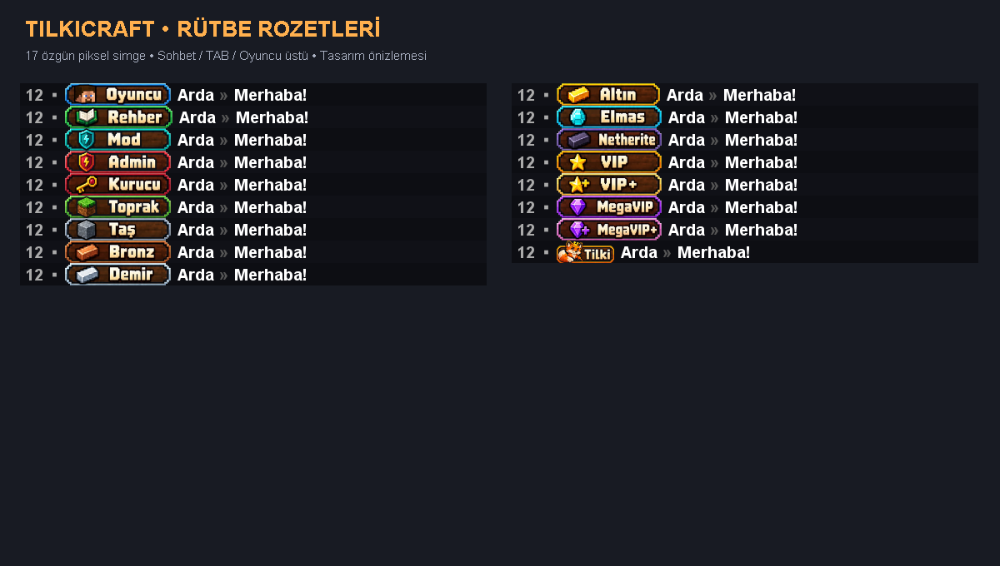

# TilkiTags

TilkiCraft için 17 özgün piksel rozet: sohbet, TAB oyuncu listesi ve oyuncunun başının üzerinde isim ön eki. Spigot **1.21.4**, Java **21**, LuckPerms **5.x** gerektirir. EssentialsX ve EssentialsXChat isteğe bağlı desteklenir.

## Kurulum

1. Sunucuyu durdur, `TilkiTags-1.3.4.jar` dosyasını `plugins` klasörüne koy ve yeniden başlat. LuckPerms kurulu olmalı.
2. Yönetici olarak `/tilkitags setup` çalıştır. 17 kozmetik grup hazırlanır. Mevcut grup üyelikleri veya yetkileri silinmez; gruplara yönetici/Essentials/oyun yetkileri eklenmez. Bunları LuckPerms'te ayrıca yönetirsin.
3. Grup ata: `/lp user Arda parent add vipplus` veya `/lp user Arda parent add tilki`. `parent add` mevcut başka grupları korur. Kaldırmak için `parent remove <grup>` kullan.
4. Oyuncu rozet paketini kabul eder; ZIP hazır GitHub bağlantısından indirilir. Sunucuya ZIP koymak gerekmez. Paket varsayılan olarak zorunludur.

Mevcut LuckPerms grupları zaten config'deki adlardan biriyle eşleşiyorsa setup gerekmeden tag görünür. Bilinmeyen gruplarda Oyuncu tagı kullanılır. Grup değişiklikleri yaklaşık yarım saniyede yansır.

## Taglar

| Görünüm | LuckPerms grup adı | Simge |
|---|---|---|
| Oyuncu | `oyuncu` veya `default` | Oyuncu portresi |
| Rehber | `rehber` | Yeşil rehber kitabı |
| Mod | `mod` | Yeşil şimşek kalkanı |
| Admin | `admin` | Kırmızı şimşek kalkanı |
| Kurucu | `kurucu` | Yakutlu altın taç |
| Toprak | `toprak` | Çimenli toprak bloğu |
| Taş | `tas` | Taş bloğu |
| Bronz | `bronz` | Bronz külçe |
| Demir | `demir` | Demir külçe |
| Altın | `altin` | Altın külçe |
| Elmas | `elmas` | Buz mavisi elmas |
| Netherite | `netherite` | Mor/gri netherite külçesi |
| VIP | `vip` | Altın yıldız madalyası |
| VIP+ | `vipplus` | Altın madalya ve artı |
| MegaVIP | `megavip` | Mor kristal, altın taç ayrıntısı |
| MegaVIP+ | `megavipplus` | Mor kristal, taç ve artı |
| Tilki | `tilki` | Taçlı turuncu tilki, altın renkte `Tilki` yazısı |

`vip+`, `vip_plus`, `megavip+`, `nethrite`, `netherit`, `taş`, `altın`, `owner`, `moderator`, `helper` gibi grup adları da config'deki eşlemelerle tanınır. Kurulum komutu geçerli sade grup adlarını oluşturur: `vipplus`, `megavipplus`, `netherite` vb.

## Öncelik

Kurucu > Admin > Mod > Rehber > Tilki > MegaVIP+ > MegaVIP > VIP+ > VIP > Netherite > Elmas > Altın > Demir > Bronz > Taş > Toprak > Oyuncu.

Bir kişide birden fazla grup varsa en yüksek öncelikli **tek tag** gösterilir. `ranks.*.priority` ile değiştirilebilir. LuckPerms bağlamları ve miras alınan gruplar dikkate alınır. Ayrıca tam olarak tanımlı `tilkitags.rank.<id>` izinleri desteklenir. Sırf OP olmak veya `*` joker izni almak kişiyi otomatik Kurucu tagına yükseltmez; eşleşen grup veya tam rank izni gerekir.

## Komutlar

- `/tilkitags list` veya `/tilkitags preview`: tüm tagları gör.
- `/tilkitags setup`: grupları hazırla; `tilkitags.admin` gerekir (varsayılan OP).
- `/tilkitags reload`: ayarları yenile ve paketi yeniden gönder; yönetici izni gerekir.
- `/tilkitags messagecolor <tag> <renk>`: seçilen rütbenin sohbet mesajı rengini değiştirir. Örnek: `/tilkitags messagecolor kurucu RED`. Renk `ranks.<tag>.message-color` alanına kaydedilir. `RED`, `DARK_RED`, `GOLD`, `YELLOW`, `GREEN`, `DARK_GREEN`, `AQUA`, `DARK_AQUA`, `BLUE`, `DARK_BLUE`, `LIGHT_PURPLE`, `DARK_PURPLE`, `WHITE`, `GRAY`, `DARK_GRAY` ve `BLACK` desteklenir.

## EssentialsXChat ve isimler

Spigot'ta EssentialsXChat'ın normal sohbet işlemlerinden sonra yalnızca mesajın görünen biçimi ayarlanır. Mesaj yeniden yayınlanmaz; alıcı listesi ve iptal durumu korunur. Böylece Essentials'ın mute, yerel sohbet alıcı filtreleri ve sonraki ücret kontrolü çalışmaya devam eder. EssentialsChat'ın kendi `format`/grup formatları yerine `TilkiTags/config.yml` içindeki `chat.format` kullanılır. Varsayılan: `{tag}{name}&8 » &f{message}`.

Essentials `/nick` adları sohbet ve TAB'da okunur. Baş üstü tag, gerçek Minecraft kullanıcı adının önüne scoreboard team prefix'i olarak eklenir; oyuncunun gerçek adı değiştirilmez. Bukkit display name veya LuckPerms prefix meta verisi yazılmadığından iki kez tag eklenmez. Essentials özel mesajlarının ve başka pluginlerin kendi sohbet kanallarının biçimleri değiştirilmez. Paper'ın farklı sohbet pipeline'ı bu sürümde ayrıca doğrulanmamıştır; hedef Spigot'tır.

Essentials'ın chat işleyişi kaynağı: https://github.com/EssentialsX/Essentials/tree/2.x/EssentialsChat/src/main/java/com/earth2me/essentials/chat/processing

## Kaynak paketi ve uyumluluk

- Rozetler [referans sayfasından](art/tags-source.jpg) kesilen, simgesi ve yazısı tek parça dokulardır; 45 piksel yükseklikte (5x HD) saklanır ve tam bir sohbet satırı olan 9 px yükseklikte font glifi olarak gösterilir. `EB00–EB10` ve `tilkitags:badges` namespace'i kullanılır. 256x256 font atlası sınırına uyulur; Unicode font desteği vardır.
- CombatGuns, TilkiLoginScreen ve TilkiStatsHUD paketlerinin yanına ayrı UUID ile eklenir. Varsayılan istek gecikmesi 140 tick. Title, scope, crosshair veya bossbar'a yazılmaz.
- Paketi indirmemiş oyuncuya kutu göstermek yerine yazılı tag kullanılır. TAB adı global olduğu için herkesin paketi yüklenene kadar TAB'da metin tagları kullanılır. Sohbette yalnızca mesajın tüm alıcıları hazırsa rozet eklenir. Aynı scoreboard'u paylaşan izleyicilerin hepsi hazırsa o board'da rozet açılır.
- İsim üstü için oyuncuların o an kullandığı scoreboard'lara yalnızca TilkiTags takımları eklenir. TilkiStatsHUD'ın scoreboard'u değiştirilmez; yeni board oluşturulunca sonraki yenilemede taglar eklenir.
- Başka pluginin takımı oyuncuyu zaten yönetiyorsa varsayılan `nametag.respect-existing-teams: true` o takımı korur ve konsola bilgi verir. O oyuncunun baş üstü tagı için diğer nametag sağlayıcısını kapat. Ayarı false yapmak takım üyeliğini taşır ve diğer pluginin collision/friendly-fire özelliklerini etkileyebilir. TAB/nametag için tek sağlayıcı kullanılması önerilir.
- Kapanışta kendi takımları silinir. TAB adı hâlâ bu pluginin yazdığı değerse önceki isim geri yüklenir. Yeni gruplar ve kullanıcı grup üyelikleri silinmez.
- Hedef istemci 1.21.4. ViaVersion, farklı sürümlerin kaynak paketlerini otomatik uyumlu hâle getirmez. Başka plugin tüm paketleri sıfırlarsa bu paket de yeniden gönderilmelidir.

## Derleme ve doğrulama

`mvn package` (Java 21). `java tools/BuildTagsPack.java` font paketini ve `art/tags-preview.png` dosyasını üretir. `powershell -ExecutionPolicy Bypass -File tools/ValidatePack.ps1` paketi kontrol eder.

Rank önceliği, takma ad/format güvenliği, grup eşlemeleri, 17 rozetin team metin sınırı ve paketsiz fallback için 5 test; bitmap/JSON/ZIP/font/SHA1 kontrolleri vardır. Canlı sunucu/istemciyle henüz test edilmedi. Kontrol edilmesi gerekenler: farklı rütbeler; OP'de varsayılan tag; grup değiştirme; iki oyuncunun TAB ve baş üstü görünümü; paket indirirken metin fallback; Essentials mute/local chat/nick; TilkiStatsHUD panelini aç/kapat; giriş ekranı ve sniper scope.

## 1.1.0 — Tek parça yazılı rozetler

Her rozetin simgesi ve rütbe yazısı artık aynı PNG'nin içindedir. Paket yüklendiğinde tag tek font glifi olarak gönderilir; yanına ayrıca label yazılmaz. Paket indirilene kadar eski metin fallback'i korunur. Rozetler 18 px yüksekliğinde, en fazla 140 px genişliğinde dokulardır; ekranda 9 px yüksekliğinde gösterilir.

TilkiStatsHUD 1.0.1 ile aynı rozet sidebar rütbe satırında ve üst şeritte görünür. HUD, `getRankBadge(subject, viewer)` API'sinden veriyi alır; her oyuncunun kendi paket durumunu dikkate alır. Eski HUD JAR'ı yerine yeni sürüm yüklenmelidir. `sidebar.use-tilkitags: false` ile bu bağlantı kapatılabilir. PAPI/Vault rütbesi bu bağlantı açıkken rozetin önüne geçmez.

Güncelleme: sunucuyu durdur, eski TilkiTags ve TilkiStatsHUD JAR'larını kaldırıp yenilerini koy, yeniden başlat ve oyuna yeniden gir. Mevcut gruplar, üyelikler ve ayarlar korunur. Eski resmi tag paketi URL/SHA1 bilgileri otomatik güncellenir; özel hosting kullanıyorsan yeni ZIP/hash bilgilerini sen güncellemelisin. Gruplar zaten varsa setup tekrar gerekmez. Baked rozet içindeki yazı değişecekse BuildTagsPack.java ile doku yeniden üretilmelidir; config label alanı metin fallback'ini değiştirir.

Doğrulama: 5 rank/glyph/format testi, HUD tarafında 4 test (rozet API sözleşmesi dahil), PNG/JSON/font/ZIP/SHA1 kontrolleri. Canlı istemci görünümü henüz doğrulanmadı.

## 1.3.4 — Referans rozetleri, taşmasız sohbet

17 rozet gönderilen [rozet sayfasından](art/tags-source.jpg) birebir kesilir: koyu zemin kenarlardan temizlenir, rozet kırpılır ve 45 piksel yüksekliğe premultiplied alfa ile küçültülür. Tilki dahil tüm rozetler 9 piksel yükseklik ve 8 ascent kullanır. Bu bir sohbet satırının tamamıdır: rozet olabildiğince büyüktür ama üst veya alt satıra taşmaz. 1.3.3'teki 11 piksellik Tilki rozeti üst satıra biniyordu. [Önizleme](art/tags-preview.png) GUI ölçeği 3'te ardışık sohbet satırlarını simüle eder.

## 1.3.3 — Büyük Tilki etiketi ve özel turuncu

Tilki etiketi sohbet, TAB ve oyuncu adı üstünde daha rahat okunması için 11 piksele büyütüldü. `/tilkitags messagecolor <tag> ORANGE` komutu Tilki logosuna uyan `#FF8200` mesaj rengini uygular.

## 1.3.2 — Yeni Tilki etiketi

`tilki` grubunun EB10 glifi, taçlı tilki ve ahşap “Tilki” tabelasını tek parçada gösteren yeni görselle değiştirildi. Görsel [kaynak dosyadan](art/tilki-tag-source.png) şeffaf zeminli 76×27 dokuya dönüştürülür ve oyunda 9 piksel yüksekliğinde görünür. Diğer 16 rütbe etiketi değiştirilmedi.
## 1.2.0 — Beyaz isimler ve piksel yazı

Chat, TAB ve oyuncu üzerindeki isimler beyazdır. Essentials takma adlarının renk/kalınlık kodları temizlenir. Rozet renkleri korunur; yazılar kalın piksel harflerle çizilir. En yüksek VIP rozeti `Tilki` olarak yazılır. Eski config dosyalarındaki isim renkleri bu davranışı değiştirmez.

Ada seviyesi, PlaceholderAPI üzerinden `%superior_island_level_format%` ile okunur; sohbet, TAB ve avatar üzerinde ismin önünde gösterilir. `island-level.placeholder` ile değiştirilebilir. Çözülmeyen değer 0 olur; diğer eklentilerin Bukkit API çağrıları sohbet iş parçacığında yapılmaz, ana iş parçacığında hazırlanan değer kullanılır.

## 1.3.0 — HD rozetler

Rozet yazıları Noto Sans Bold ile antialias kullanılarak 3x çözünürlükte oluşturulur. Dokuz piksel mantıksal satır yüksekliği ve tek parça rozet davranışı korunur. Her rozet hücresi atlasın 256 piksel sınırını aşmaz. Oluşturucu Noto Sans fontunu kardeş TilkiInterface projesinin font klasöründen okur. Ortak paket TilkiResourcePack 1.0.2'dir.
